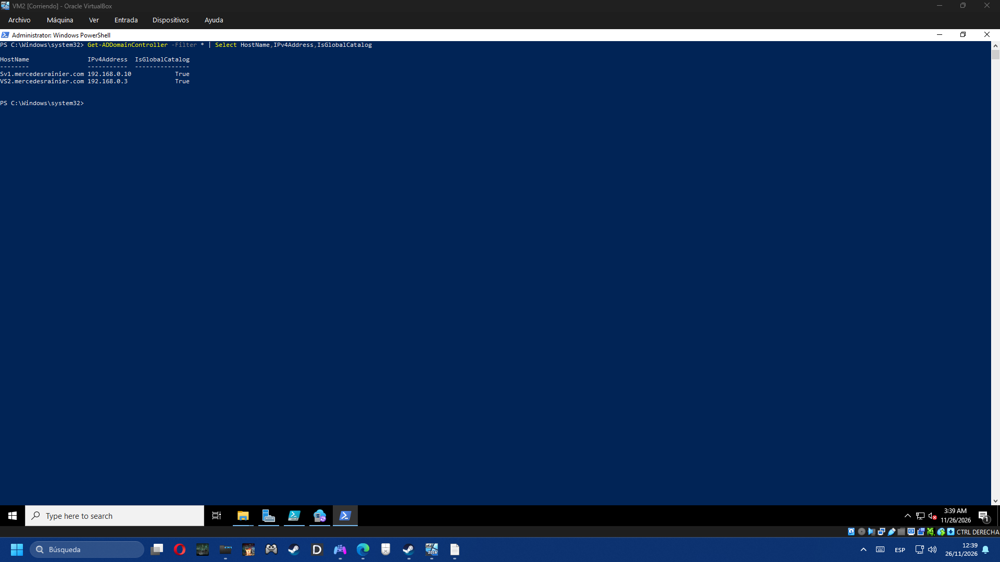
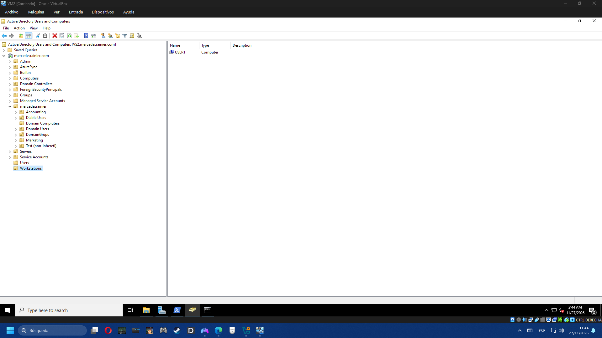
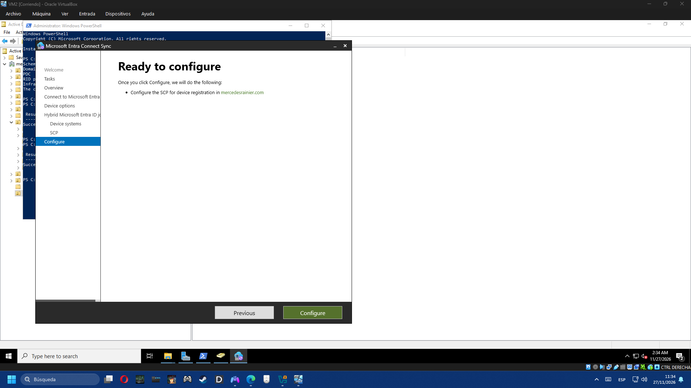
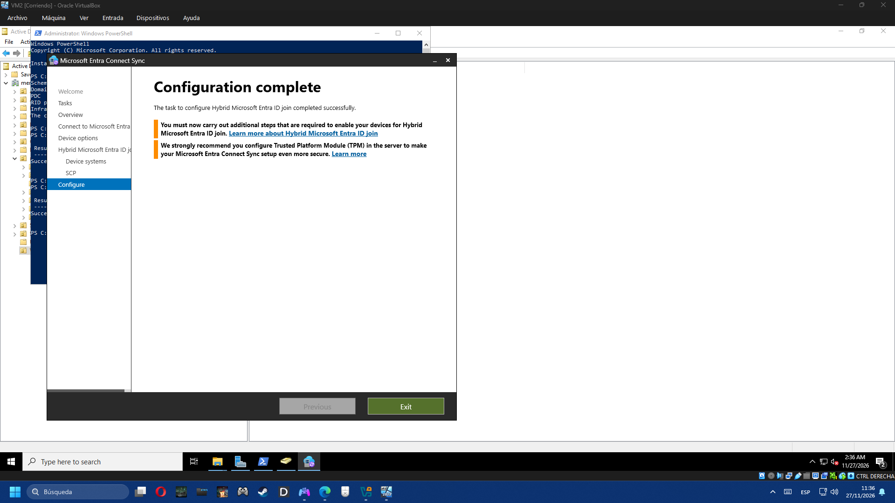
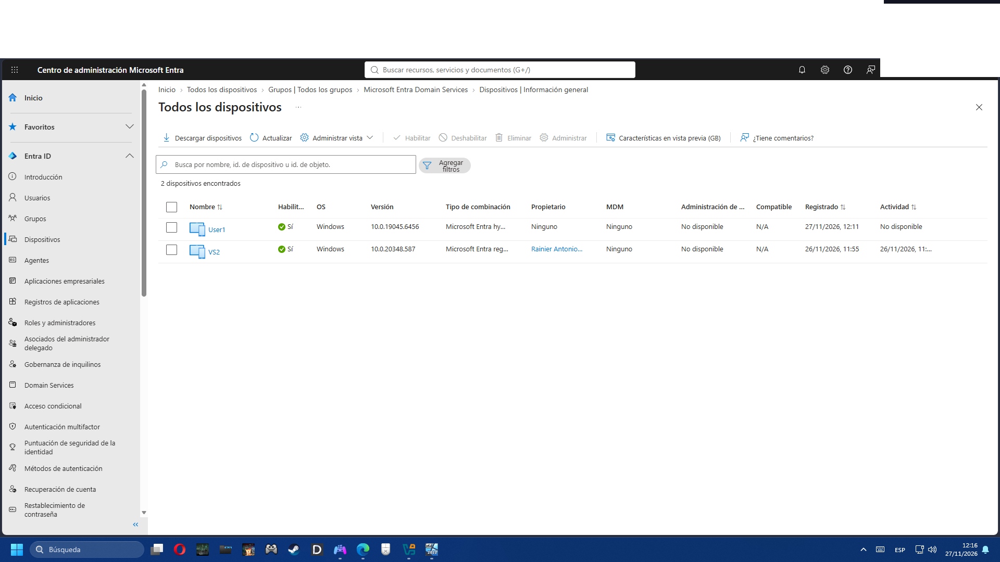
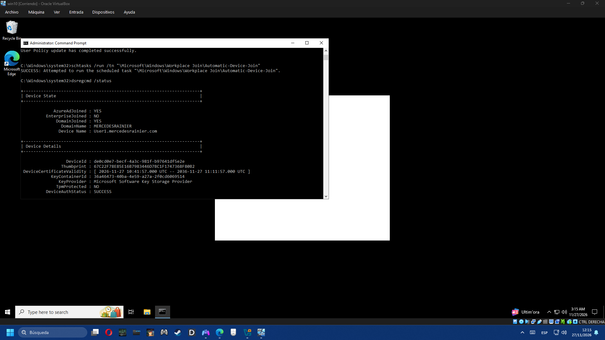

# Home Lab - Active Directory + Microsoft Entra ID Hybrid
## 1. Visual Architecture

                    ┌─────────────────────────┐
                    │   Microsoft Entra ID    │
                    │      Cloud Tenant       │
                    └───────────┬─────────────┘
                                │
                  Password Hash Sync (PHS)
                    Hybrid Entra Join
                                │
                    ┌───────────▼─────────────┐
                    │ Microsoft Entra Connect │
                    │          VS2            │
                    └───────────┬─────────────┘
                                │
      ┌─────────────────────────┴─────────────────────────┐
      │            On-Premises Active Directory           │
      └─────────────────────────┬─────────────────────────┘
                                │

┌───────────────┐     Replication      ┌────────────────┐
│ SV1           │◄────────────────────►│ VS2            │
│ Server 2016   │                      │ Server 2022    │
│ DC + DNS      │                      │ DC + GC        │
│ FSMO Roles    │                      │ Entra Connect  │
└───────┬───────┘                      └───────┬────────┘
        │                                      │
        └──────────────┬───────────────────────┘
                       │
               ┌───────▼────────┐
               │ USER1          │
               │ Windows 11     │
               │ Domain Joined  │
               │ Hybrid Joined  │
               └────────────────┘

Fully functional hybrid identity lab.

## Infrastructure

| Server | OS | Role | IP |
|--------|----|------|----|
| SV1 | Windows Server 2016 | Domain Controller, DNS, FSMO | 192.168.0.10 |
| VS2 | Windows Server 2022 | Domain Controller, Global Catalog, Entra Connect | 192.168.0.3 |
| USER1 | Windows 11 | Hybrid Microsoft Entra Joined | - |

**Domain:** mercedesrainier.com  
**NetBIOS:** MERCEDESRAINIER  
**Tenant:** [Redacted].onmicrosoft.com

---

## Phase 1 – Active Directory + DNS
- AD DS installed
- DNS configured
- Client joined to domain

**Evidence:**  

---

## Phase 2 – Replication + FSMO
- `dcdiag /q` clean
- `repadmin /replsummary` clean
- FSMO roles verified

**Evidence:**  
  

---

## Phase 3 – UPN + Tenant
- All UPNs changed from `.local` to `.com`
- Tenant and Global Admin validated

**Evidence:**  

---

## Phase 4 – Microsoft Entra Connect
- Method: Password Hash Synchronization (PHS)
- Source anchor: Azure managed
- All users synchronized successfully

**Evidence:**  
  
  

---

## Phase 5 – Hybrid Microsoft Entra Join

### Problem found
USER1 was in `OU=Workstations`, but that OU was **not** included in Entra Connect scope.  
Error: `error_missing_device`

### Solution
1. Included the Workstations OU in Entra Connect
2. Ran `Start-ADSyncSyncCycle -PolicyType Initial`

### Result
AzureAdJoined : YES
DomainJoined  : YES
USER1 appears correctly in Microsoft Entra → Devices

**Evidence:**  
  
  
  
  

